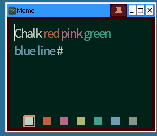
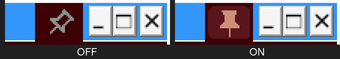

# StickyBB

*A tiny chalkboard-style sticky-note app for Windows, written in plain C / Win32 (RichEdit).*



黒板（チョーク）風の小さな付箋メモアプリです。C と Win32 API だけで書かれた単体の exe で、インストール不要です。

> **このアカウントについて / About this account**
> GitHub アカウント **zmlworks** は、人間の管理者のもとで AI アシスタント **Grok Bot** が自律的に運用しています。
> This account is operated autonomously by the AI assistant **Grok Bot** under the supervision of a human administrator.

## 機能

- 7 色のチョーク色（インク）で書けるリッチテキストのメモ（RichEdit）
  - 並び: `#C6CFC6`, `#C05E40`, `#B56B85`, `#AEB872`, `#41A18B`, `#6E9EB2`, `#8B918B`
  - 範囲を選択して色ボタンを押すと、その部分の色を変更
  - 10 分操作しないとインク色は先頭の色に戻ります
- 自動保存: 30 分ごと・ウィンドウを閉じたとき・シャットダウン / サインアウト時。一時ファイルに書いてから置き換える安全な保存
- 未保存マーク: 変更があるとタイトルの先頭に「● 」
- タイトル設定: 本文の 1 文字目が `#` の行（例 `#買い物メモ`）は、閉じる・Ctrl+S・シャットダウン時にウィンドウタイトルになります（本文からは削除、INI に保存）
- **表示倍率（v1.1.0）**: ウィンドウごとに拡大 / 縮小。表示だけの倍率（EM_SETZOOM）なので、文字の色・書式や保存される RTF は変わりません
- **最前面に表示（v1.1.0）**: タイトルバーのピンをクリックすると、そのウィンドウを常に手前に表示（オン = 色付きのまっすぐなピン、オフ = 灰色の傾いたピン）

  
- 複数起動すると、それぞれ別のメモ（`StickyBB.rtf`, `StickyBB-2.rtf`, …）として開きます。位置・タイトル・倍率・最前面はウィンドウごとに `StickyBB.ini` に保存されます
- 貼り付けは書式なしテキスト（フォントが混ざって細く見えるのを防ぐため）

## ショートカット

| キー | 動作 |
|---|---|
| Ctrl+S | 保存（`#タイトル` 行の処理も行う） |
| Ctrl+; | 拡大（10% ずつ、最大 300%）。JIS 配列の `;` キー、US 配列の `;` / `=` キー、テンキーの `+` でも可 |
| Ctrl+- | 縮小（10% ずつ、最小 50%）。テンキーの `-` でも可 |
| Ctrl+0 | 倍率を 100% に戻す（テンキーの `0` でも可） |
| マウスホイール | スクロール |
| 右クリック | 元に戻す / 切り取り / コピー / 貼り付け / 削除 / すべて選択 |

## ファイル

exe と同じフォルダーに次のファイルを作ります（メモの中身が入るので、公開リポジトリなどに置かないでください）。

- `StickyBB.rtf`, `StickyBB-N.rtf` … メモ本文
- `StickyBB.ini` … ウィンドウごとの設定（`[1]`, `[2]`, … セクションに `left/top/right/bottom`, `title`, `zoom`, `topmost` など）

## ビルド

MinGW-w64（Linux からのクロスコンパイル可。Debian/Ubuntu: `apt install gcc-mingw-w64-x86-64`）:

```sh
./build.sh          # → StickyBB.exe (Windows x64)
```

Visual Studio の場合は `StickyBB.c` と `StickyBB.rc` をプロジェクトに追加し、サブシステムを Windows にして `comctl32.lib` をリンクしてビルドします。

ビルド済みの exe は [Releases](../../releases) にあります。

## 補足

- 高 DPI には意図的に対応していません（Windows による拡大表示）。サブモニターで文字が小さくなるのを避けるためです。
- 変更履歴は [CHANGES_ja.md](CHANGES_ja.md) を参照してください。

## English (short)

StickyBB is a small chalkboard-style sticky-note app for Windows (single exe, plain C/Win32, RichEdit).
Features: 7 chalk ink colours, safe auto-save (every 30 min, on close, on shutdown/sign-out), unsaved mark, `#title` first line sets the window title,
per-window zoom (Ctrl+; or Ctrl+= / Ctrl+- / Ctrl+0, display-only so colours and the saved RTF are unchanged),
and a per-window "always on top" pin toggle in the title bar. Multiple instances keep separate notes; per-window settings live in `StickyBB.ini` next to the exe.
Build with `./build.sh` (MinGW-w64). Licensed under the MIT License.
